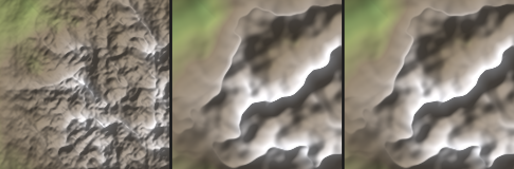
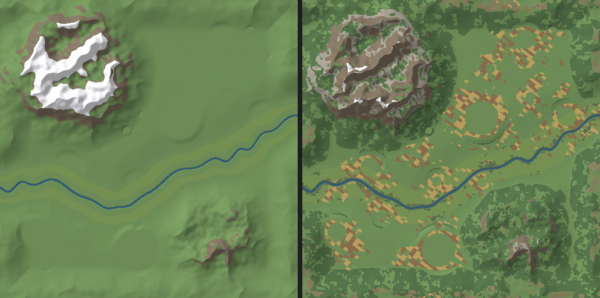

# 08 Landschaftsregeln: Relief, Boden, Wasser, Wald (Technical Artist TEAM-02, Design Sprint „Welt“, 02.11.2026)
Zweck: Regeln für Relief, Böden/Biome, Wasser und Wald der Karte (512² Felder à 25 m), mit belegter Parameteränderung im Generator.
Status: Skizze, Phase 2. Kennung: [M] gemessen in der Arbeitskopie, [S7] Bestand im Code, [~] Fachwissen ungeprüft, [Annahme] Setzung TEAM-02. Maße folgen `01_skalen.md` (Art Director).

## Kurzfassung
| Punkt (Basti) | Ursache im Stand S7 | Änderung | Beleg |
|---|---|---|---|
| Berge „zu organisch“ | Gebirgsrauschen faltet **jede Oktave** einzeln (ridged), 5 Oktaven bis 119 m Wellenlänge: 22,6 % der Amplitude liegen unter 500 m Wellenlänge | Grat aus der **Summe** falten, 4 Oktaven, Gain 0,42, Grundwelle 1,9 → 2,6 km. Anteil unter 500 m: **4,4 %** | Hochpunkte 82 → 29, Krümmungswechsel 7,4 → 3,7 je km [M] |
| Gelände uniform | Hügelamplitude überall gleich (20–26 m), und der Talboden wird bis **3 km** neben dem Fluss eingeebnet (halbe Karte) | Reliefzonen (Ebene 4 m, Hügelland 42 m + Kuppen 14 m), Talboden flach bis 700 m, Übergang bis 2 km | Flachland-Spanne (500 m) P10 11,6 → 5,9 m, P50 39 → 56 m: Ebenen ebener, Hügel hügeliger [M] |
| Boden kaum unterscheidbar | Shader kennt nur Gras/Aue/Fels/Schnee, Wiese = 84 % der Fläche | 11 Bodenklassen nach Höhe, Neigung, Feuchte, Siedlungsnähe; Bodenkarte als Textur | Wiese 84 % → 39 % [M], Bild unten |
| Wasser unterproportional | Fluss 32–72 m, Maske max. 3 Felder | Fluss 60–100 m, Mäander mit 11–15 × Breite, Aue 5–20 × Breite | Wasserfelder 1.101 → 1.902, gerade querbar 88 → 97 % [M] |

Der Generator mit den Profilen liegt in der Arbeitskopie: `ws_c/slice/tools/world_gen.py --relief s7|ds_gebirge|ds_v2`. Profil `s7` ist **byte-gleich** zum Stand in `world/data` (md5 `d9a5f0c2…` geprüft). Varianten liegen in `ws_c/_out/<profil>/`, Kennzahlen in `ws_c/_out/kennzahlen.json` (Skript `ws_c/tools_ds/relief_kennzahlen.py`). Beide neuen Profile bestehen den S7-Validator (Seed 7).

## (a) Relief

### Reliefstufen
Klassifikation je Feld nach lokaler Spanne (max − min im Umkreis 500 m) und Höhe. Ziel-Anteile gelten für die Innenfläche (ohne Randring 1 km).

| Stufe | Spanne 500 m | Höhe | typ. Neigung | Ziel-Anteil | Lage auf der Karte | S7 [M] | ds_v2 [M] |
|---|---|---|---|---|---|---|---|
| Ebene | < 25 m | 30–250 m | < 2 % | 20–30 % | Talaue ± 700 m um den Fluss, 1–2 Platten (Lössplatte) | 16 % | 21 % |
| Hügelland | 25–90 m | 120–350 m | 2–15 % | 30–40 % | Zonen von 3–6 km zwischen Tal und Gebirge, mit Kuppen | 36 % | 30 % |
| Mittelgebirge | 90–280 m oder 350–700 m | bis 700 m | 10–35 % | 15–20 % | Vorland der Massive, kleines Massiv 2 | 19 % | 18 % |
| Gebirge | > 280 m oder > 700 m | bis 1.120 m | 30–100 %, Fels > 60 % | ≤ 15 % innen + Randring | Massiv 1 auf der Gegenseite des Flusses, Randring | 29 % | 32 % |

Verteilungsregeln:
- **Kein Gebiet über 3 km ohne Stufenwechsel.** Das ist der Kern gegen „uniform“. Die Reliefzonen-Maske hat eine Wellenlänge von 6 km.
- Gebirge nur als **Massiv oder Rand**, nie als Streuung. Zwischen Ebene und Gebirge liegt immer Hügelland oder Mittelgebirge (Vorland ≥ 1 km).
- Der Fluss läuft durch die tiefste Stufe. Die Aue ist die einzige große Ebene, eine zweite Platte ist optional.
- Der Gebirgsanteil innen bleibt mit 32 % zu hoch (Randring zählt mit). Das ist nicht Teil dieses Vorschlags. Vorschlag für W-06: Massiv-1-Radius 3,3–4,0 → 2,8–3,4 km [Annahme, nicht gerechnet].

### Gebirge: Parameteränderung (belegt)
Datei `tools/world_gen.py`, Klasse `Terrain.height`, neue Funktion `grat()`, Profil `RELIEF["ds_gebirge"]`.

| Parameter | S7 | Vorschlag | Wirkung |
|---|---|---|---|
| Gratbildung | `fbm(..., ridged=True)`: jede Oktave `1 − abs(n)` | `1 − abs(fbm) × 1,6`, Domäne um 31° gedreht | Wenige lange Gebirgszüge statt vieler kurzer Grate. Die Drehung verhindert achsparallele Perlin-Gitterlinien (im ersten Versuch mit 3 Oktaven sichtbar) |
| Oktaven Massiv 1 / Massiv 2 / Rand | 5 / 4 / 5 | 4 / 4 / 4 | kleinste Welle 119 m → 325 m |
| Gain | 0,50 | 0,42 | Anteil der Amplitude unter 500 m Wellenlänge 22,6 % → 4,4 % |
| Grundwellenlänge M1 / M2 / Rand | 1.900 / 1.500 / 2.400 m | 2.600 / 2.000 / 3.000 m | breitere Täler, Formen in Kamerahöhe 2 km lesbar |
| Exponent M1 / M2 | 1,6 / 1,5 | 1,35 / 1,3 | Grate tragen, Gipfel etwas breiter |
| Höhen (Sockel 150 m, Amplitude 820–900 m) | – | unverändert | Validator „höchster Punkt ≥ 800 m“ bleibt erfüllt (1.121 m) |

**Kennzahlen** (Seed 7, je Variante gleiche Massivlage) [M]:

| Kennzahl | S7 | ds_gebirge (nur Gebirge) | ds_v2 (alles) |
|---|---|---|---|
| Höhe min–max | 29–1.083 m | 29–1.123 m | 29–1.121 m |
| Hochpunkte (lokales Max. 225 m, > 400 m) | **82** | **36** | **29** |
| davon markant (Max. in 1 km, > 150 m Überhöhung) | 9 | 8 | 9 |
| Krümmungswechsel im Gebirge je km | **7,35** | **3,67** | **3,66** |
| Kleinform im Gebirge (Std. Hochpass 100 m) | 18,1 m | 17,0 m | 17,0 m |
| Neigung im Gebirge Median / P90 | 476 / 911 ‰ | 488 / 894 ‰ | 487 / 888 ‰ |
| Neigung Landfelder < 2 % / 2–6 % / 6–15 % / 15–30 % / 30–60 % / > 60 % | 19,5 / 20,9 / 16,0 / 21,8 / 15,1 / 6,6 % | 20,7 / 19,0 / 17,4 / 20,4 / 16,2 / 6,3 % | 27,4 / 10,0 / 17,0 / 21,4 / 17,8 / 6,3 % |
| Validator „Hügel in der Fläche“ (Soll ≥ 10 %) | 26,9 % | 25,4 % | **13,8 %** |
| Layout-Versuche bis gültig | 6 | 12 | 0 |

Lesart: Die Zahl der Spitzen halbiert sich, die Faltigkeit halbiert sich, die Steilheit bleibt gleich. Das Gebirge bleibt also ein Gebirge, wird aber ruhiger. Die Kleinform-Streuung sinkt kaum, weil die neuen Grate schärfer sind (V-Falte der Summe).

Bilder: `bilder/08_relief_vergleich_massiv.png` (gleicher 4-km-Ausschnitt S7 | ds_gebirge | ds_v2) und `bilder/08_relief_vergleich_karte.png` (ganze Karte).

### Reliefzonen und Tal (Profil ds_v2)
| Parameter | S7 | ds_v2 | Hinweis |
|---|---|---|---|
| Hügelamplitude (fbm 3,2 km) | 20–26 m überall | Ebene 4 m … Hügelland 42 m, Maske fbm 6 km | Zonen statt Einheitswelle |
| Kuppen (fbm 900 m) | – | bis 14 m, nur im Hügelland | sichtbare Einzelhügel für Burg, Kirche, Windmühle |
| Kleinrelief (420 m) | 1,5 m | 1,0 m | |
| Talboden flach bis / Übergang bis | 300 m / 3.000 m | 700 m / 2.000 m | Aue = 5–20 × Flussbreite. 250 m / 1.400 m scheitert an Lenas Lageregeln (Mühle braucht Aue in 300–1.500 m Flussabstand, Kleinstadt braucht Ebene) [M] |

Bild: `bilder/08_relief_vergleich_spanne.png` (lokale Spanne, hell = bewegt). In S7 ist der Talboden ein großer, gleichförmig grauer Bereich. In ds_v2 trennen sich die dunkle Aue und das hellere Hügelland.

**Folge für Lenas Regeln:** „Aue“ ist heute definiert als Ebene mit 300–1.500 m Flussabstand. Mit echtem Hügelland wird dieses Band schmaler. In ds_v2 hält es noch (Aue 6,2 %), knapper wird aber der Validator-Wert „Hügel in der Fläche“ (13,8 % bei Soll 10 %). Vorschlag: Aue-Band auf 0–1.000 m (Mühle am Wasser, historisch richtig) [Annahme].

**Nebenbefund Stadtplateaus:** Die Stempel für Stadtkerne erzeugen **kreisrunde Böschungsringe** (deutlich sichtbar in `08_relief_*_karte.png` und `ds_v2_boden_vergleich_stadt.png`). Sie wirken konstruiert (Basti Punkt 8). Regel: Plateaus folgen der Ortsform und dem Hang (Terrassen quer zum Gefälle, Radius ±20 % verrauscht). Weitergabe an den Stadt-/Level-Designer.

## (b) Boden und Biome

### Regeln (Reihenfolge = Priorität, spätere überschreiben)
| Klasse | Bedingung | Farbe (sRGB) | Kontrast Saum / Marker (S-08, ≥ 3:1 eines) | Anteil S7 → ds_v2 [M] |
|---|---|---|---|---|
| Wiese/Weide | Grundfläche | `#73945C` (S-08 gras) | 5,3 / 2,1 | 84 → 39 % |
| Auenboden | Flussmaske Bit 2 oder < 500 m zum Wasser und Neigung < 2,5 % | `#7D9959` (c_aue) | 5,7 / 2,0 | 6 → 7 % |
| Sumpf | Aue, Neigung < 1,2 %, Feuchte > 0,62, fleckig (≈ 10 % der Aue) | `#5F7352` | 3,5 / 3,2 | 0 → 0,7 % |
| Acker hell / dunkel | Gürtel um Siedlungen bis 4 Ortsradien (max. 1,6 km, Rand verrauscht ±500 m), Neigung < 6 %, nicht nass, < 450 m; Gewann-Blöcke 200 × 125 m, 55 % hell | `#C2A866` / `#8F7350` | 7,8 / 1,4 und 4,1 / 2,7 | 0 → 9 % |
| Heide | Feuchte < 0,12, 180–520 m, Neigung < 15 %, > 1,2 km von Orten, fleckig | `#8C8462` | 4,8 / 2,3 | 0 → 2 % |
| Waldboden | Hang 12–60 % unter 900 m oder 380–900 m ab 5 %, > Ortsradius + 300 m, plus Wald-Polygone | `#55734A` | 3,4 / 3,3 | 0 → 30 % |
| Schotter | Hangschutt 35–60 % über 550 m | `#A39D90` | 6,7 / 1,7 | 0 → 3 % |
| Fels | > 60 % oder über 850 m ab 25 % | `#807361` (S-08 berg_stein) | 3,9 / 2,9 | 5 → 7 % |
| Schnee | über **1.000 m** (S7: 780 m), Neigung < 55 % | `#F2F2F7` | 16,2 / 1,5 | 4,6 → 0,2 % |
| Ufer | 1 Feld Saum am Wasser | `#6B7054` (c_ufer) | 3,5 / 3,2 | – |
| Wasser | Flussmaske Bit 1 | `#345F7E` (water.gdshader c_tief) | 2,7 / 4,2 | 0,7 % |

Feuchte = Flussnähe (bis 1,5 km) × 0,6 + Mulde/Kuppe gegen 1-km-Umfeld (±0,3) + Rauschen (±0,2) [Annahme]. Die Farben sind Kenney-Flachfarben (Nature Kit: Gras `#2CD8B8`, Erde `#E28357`, Stein `#B8E2E8` im Rohwert), auf das gedämpfte S-08-Grün heruntergemischt, damit Marker und Ghost lesbar bleiben. Alle Klassen bestehen die 3:1-Regel über Saum oder Füllung.

Bilder: `bilder/ds_v2_boden_vergleich.png` (links S7-Shaderlogik, rechts Regeln), `bilder/ds_v2_boden_vergleich_stadt.png` (4 km um die größte Stadt, 3×), `bilder/ds_v2_boden_legende.png`. Skript: `ws_c/tools_ds/boden_vorschau.py` (Regeln dort als Referenz für den Shader).

Bekannte Schwäche der Vorschau: Der Ackergürtel spart den S7-Stadtradius (225–800 m) aus und zeichnet so Ringe. Mit den Ortsgrößen aus `01_skalen.md` F (Dorf r 125–200 m) und Äckern, die an Hofstellen hängen statt am Mittelpunkt, verschwindet das.

### Umsetzung im Terrain-Shader (ohne Perf-Gate zu reißen)
| Weg | Inhalt | Kosten | Pro | Contra |
|---|---|---|---|---|
| **A Bodenkarte (empfohlen)** | Textur 512² RGBA8 wie `fluss_maske`: R Acker (Wert = Gewann-Ton), G Heide, B Sumpf, A Wald. Wiese, Aue, Fels, Schotter, Schnee, Ufer bleiben prozedural (Höhe, Neigung, Flussmaske) | 0 Draw Calls, 0 Dreiecke, 1 MB VRAM, +1 Texturzugriff und ca. 15 ALU je Pixel | zur Laufzeit beschreibbar (Farm legt Acker an: 1 Pixel-Rechteck, `ImageTexture.update`), Kanten mit `filter_nearest` + Rauschen scharf, Ackerstreifen im Shader aus Weltposition (`fract` quer zur Gewannrichtung, 8–15 m) | ein Sampler mehr |
| B Vertexfarben | `Mesh.ARRAY_COLOR` je Knoten (263k × 4 B) | 0 DC, 0 Dreiecke, 1 MB Vertexpuffer, kein Texturzugriff | billigster Weg, kein Sampler | Übergänge immer 25 m weich (Acker verschwimmt), jede Änderung baut einen Chunk neu (64² Knoten) |
| C klassisches Splatting mit Texturen | 4–8 Bodentexturen | +4–8 Zugriffe, Downloads | Detail | Stilbruch zu Kenney-Flachfarben, teurer, Kachelmuster |

Rechnung Perf-Gate: Übersicht S7 heute 755.732 Dreiecke / 250 DC [S7 `perf_s7_baseline_s7.csv`]. Weg A und B ändern weder Dreiecke noch Draw Calls. Nebenbei: der Shader liest `fluss_maske` zweimal (Aue und Rinne). Ein Zugriff reicht (RG in einem `texture()`).

Gegenposition **Felix (Technik):** Weg B reicht, weil Bodenklassen am Feld hängen und die Sim ohnehin in Feldern rechnet. Ein weiterer Sampler kostet auf schwachen iGPUs im Compatibility-Renderer messbar. **Antwort:** Farmen müssen Äcker zur Laufzeit setzen. Ein Chunk-Neubau je Farm ist teurer als ein Textur-Update. Der Zugriff ersetzt den doppelten Maskenzugriff, unterm Strich also +0.
Gegenposition **Sophie (Art):** 11 Klassen sind zu bunt für die Übersicht, Railway Empire lebt von 3–4 Flächen. **Antwort:** In der Übersicht dominieren 4 Flächen (Wiese 39 %, Wald 30 %, Acker 9 %, Aue 7 %). Sumpf, Heide und Schotter sind Akzente unter 3 %.

## (c) Wasser

### Breiten und Darstellung (nach `01_skalen.md` E, nicht überzeichnet, E1)
| Gewässer | Breite | Felder | Heightmap | Bild | Sim |
|---|---|---|---|---|---|
| Mühlgraben | 3 m | 0,12 | nein (oder 1-m-Kerbe) | Band-Mesh mit Wasser-Shader | blockiert nicht |
| Bach | 4–6 m + Ufergehölz 10–20 m je Seite | 0,2 | nein | Band-Mesh (Demo: 5 m), Lesbarkeit über Erlen-/Weidensaum | blockiert nicht, Bachbrücke im Feld |
| Nebenfluss | 15–25 m | 0,6–1 | flache Rinne 1,5 m | Band-Mesh oder Wasser-Mesh | 1 Brückenfeld |
| Fluss (Hauptfluss) | **60–100 m** (Generator ds_v2), Band 60–120 m | 2,4–4 (Maske 2–6 je Querschnitt) | Rinne 3,5 m unter Pegel, Ufer 22 m | Wasser-Mesh über dem Gelände (09) | Wasserfelder, Brücke ≤ 8 |
| Strom | 250–350 m | 10–14 | – | – | nur mit Fähre (offene Frage 01) |
| Dorfteich | 15–30 m | < 1,2 | Mulde | Kreis-/Spline-Mesh auf eigenem 5-m-Raster | Hindernis 1 Feld |
| Mühlteich | 50–150 m | 2–6 | Mulde 2,5 m | Wasser-Mesh (Demo: 90 m) | Hindernis |
| See (optional) | 300–800 m | 12–32 | Mulde in Hügelland/Gebirgsfuß | Wasser-Mesh | Hindernis, Ufer bebaubar |

Generator ds_v2: halbe Breite `30–34 m + 16 m × Laufanteil ± 3 m` → 60–100 m (S7: `16–22 + 14 × Anteil ± 4` → 32–72 m).

### Flussverlauf
- **Mäander:** Wellenlänge 11–15 × Breite (ds_v2: λ = 2π × 170–230 m = 1,07–1,45 km), Amplitude 90–140 m, **moduliert 25–100 %** (gestreckte und schlingernde Abschnitte) und mit wandernder Phase, damit keine Sinusschlange entsteht. Großschwünge aus S7 (a1/a2, 4–18 km) bleiben.
- In Aue und Ebene mäandrieren, im Hügelland strecken (nächster Schritt: Amplitude an Reliefzone koppeln) [Annahme].
- **Technik:** Bei engen Mäandern erzeugt die S7-Abstandsnäherung `|u − u(t)| / √(1 + u'²)` Querstreifen im Talboden (im ersten ds_v2-Lauf sichtbar). ds_v2 rechnet den Abstand exakt über einen KD-Baum (scipy, Stützpunkte alle 4 m). Laufzeit 26–70 s statt 17 s.
- **Aue:** Breite 5–20 × Flussbreite (0,5–2 km), Spanne < 5 m. Boden Auenboden/Wiese, Sumpfflecken, **kein Acker in der Aue** (Hochwasser). Acker liegt auf der Terrasse dahinter.
- **Teiche/Seen:** Mühlteich an jeder Wassermühle (Signalfläche aus `01_skalen.md` D), Dorfteich am Anger. Teiche unter 3 Feldern Durchmesser sind im 25-m-Raster gezackt (Demo `s7_wasser_teich.png`). Darum bekommen kleine Teiche ein eigenes, feineres Mesh.

### Brücken: Folgen für Spiel und Validator
| Kennzahl [M] | S7 | ds_v2 |
|---|---|---|
| Wasserfelder | 1.101 | 1.902 |
| Querschnitt (Felder je Spalte) min / Median / max | 1 / 2 / 3 | 2 / 4 / 6 |
| Querschnitte gerade querbar (Lauf ≤ 8, Rampe ≤ 200 ‰, Regel wie Validator H2) | **87,9 %** | **97,3 %** |
| Aue-Anteil | 4,7 % | 6,2 % |

Regeln:
1. Brückenfelder = ⌈Breite / 25⌉ + 1 Rampe je Seite (01). Fluss 60–100 m → 3–4 Wasserfelder + 2 Rampen = Brücke 5–6 Felder ≤ `bruecke_max_felder` 8.
2. Mäander verlängern den achsparallelen Lauf (gemessen max. 6). Validator ergänzen: **max. Querschnitt ≤ 6, Median 3–5, gerade querbar ≥ 85 %** (Daniel D09 forderte ≥ 80 %).
3. Warum die Querbarkeit trotz breiterem Fluss steigt: Die breitere, flache Aue (700 m) gibt beidseitig gleich hohe Ufer, die H2-Deckhöhe bleibt flach. In S7 lag der Fluss oft am Hangfuß.
4. Bild: Steinbogenbrücke mit Bögen à 15 m (Fluss 60–100 m = 4–7 Bögen). Holzbrücke für Wege. Der Bach braucht kein Brückenfeld.

## (d) Wald und Baumdichte (Kenney Nature)
**Befund Maßstab [S7]:** Waldbäume werden mit `NATURE_SCALE 0,8` gesetzt. `tree_default` (1,708 u hoch) steht damit **34 m** hoch, die Nadelbäume 31 m. Real sind es 15–25 m. Richtig ist ein Faktor von 0,42 für Laubbäume und 0,65 für Nadelbäume (`10_import_faktoren.json`). Bei richtiger Größe braucht derselbe Wald etwa 3–4 × so viele Bäume. Das trägt nur, wenn die Fernsicht Wald über den Boden zeigt und nicht über Bäume.

| Biom | Bäume je Feld (625 m²), Nahsicht | Arten (Kenney) | Fernsicht > 2,5 km |
|---|---|---|---|
| Laub-/Mischwald < 600 m | 6–8 innen, 3–4 am Rand (≤ 2 Felder) | `tree_default`, `tree_oak`, `tree_fat`, 10 % `_dark` | Waldboden `#55734A` + Kronentupfen im Terrain-Shader (8–12 m Flecken, 0 Dreiecke) |
| Bergwald 600–900 m | 8–10 | `tree_pineDefaultA/B`, `tree_pineTallA–D`, `tree_pineRoundA–F` | wie oben, dunkler |
| Aue / Ufergehölz | 0,5 je Feld, entlang Bach/Fluss 1 je 10 m Uferlänge | `tree_tall`, `tree_thin`, `tree_simple` (Pappel-/Weiden-Ersatz) | Band entlang des Wassers (macht den 5-m-Bach lesbar, 01) |
| Wiese | 0,1 (Solitär), Hecken an Feldrainen | `tree_oak`, `plant_bushLarge`, Fantasy `hedge*` | – |
| Acker | 0; Allee an der Chaussee 1 je 12 m | `tree_default` | – |
| Heide | 0,3 (Birke, Wacholder) | `tree_thin`, `tree_cone` | – |
| Sumpf | 1 (Erle) | `tree_simple_dark` | – |
| Schotter / Fels / Schnee | 0,2 / 0 / 0 | `tree_pineSmall*` | – |
| Dorf/Garten | Obstbaum 1–2 je Hof | Fantasy `tree` (Faktor 0,12 = 7 m) | – |

**Deckel** (S7 übernehmen, ergänzen):
| Deckel | S7 | Vorschlag |
|---|---|---|
| Gartenbäume je Gebäude | 1,2 [S7] | bleibt |
| Baum-Dreiecke an Stadt-Dreiecken | ≤ 60 % [S7] | bleibt |
| Gartenbäume Sichtweite | 1.800 m [S7] | bleibt |
| Waldbäume | 1 je Waldfeld zu 50 % + 900 Streubäume, ohne Sichtweite | MultiMesh je 64²-Chunk mit `visibility_range_end` 2.500 m. **Übersicht ≤ 120k Baum-Dreiecke** (≈ 1.000 Laubbäume à 114). Nah innerhalb des Kamerakegels ≤ 6.000 Bäume |
| Draw Calls Wald | 2 (1 MultiMesh je Art) | ≤ 2 Arten × sichtbare Chunks, gedeckelt durch Sichtweite: Übersicht 0, Nah ≤ 12 |

Gegenposition **Mira (Gameplay/UI):** Kronentupfen im Shader sind nicht klickbar, Wald als Spielfläche (Holz, Sägewerk) braucht Feldgenauigkeit. **Antwort:** Die Sim liest die Bodenkarte (Kanal A Wald) und nicht die Bäume. Klick und Abholzen ändern Pixel und Baum-Chunk.

## Stimmen
| Wer | Position | Gegenposition |
|---|---|---|
| Sophie (Art) | Die neuen Grate sind lesbar, aber die Flanken wirken „plastisch“ glatt. Low-Poly-Kenney verträgt mehr Kante. | TEAM-02: Die Kante kommt aus dem Shader (Fels/Schotter an der Neigung), nicht aus dem Rauschen. Wer mehr will: Gain 0,42 → 0,46. |
| Felix (Technik) | Der KD-Abstand macht den Generator 1,5–4× langsamer und braucht scipy. | TEAM-02: Er läuft nur zur Erzeugung, nicht im Spiel. Alternative: Mäander-Amplitude so klein, dass die Näherung hält (a3 ≤ 60 m), dann aber Sinusschlange. |
| Mira (Gameplay) | Hügelland senkt den Hügel-Anteil, den der Validator misst, auf 13,8 %. Strecken werden teurer (Steigungskosten). | Lena-Regel „Hügel 1–6 %“ misst das Falsche: Gemeint ist Abwechslung. Vorschlag: Reliefstufen-Anteile als Validator-Regel statt Hügelquote. |
| Tobias (Ökonomie) | Schneelinie 1.000 m nimmt dem Gebirge sein stärkstes Signal. | Es ist 1820 im Mittelgebirge, 780 m Schnee wirkt alpin. Offen an Basti (Frage 2). |

## Offene Fragen an Basti
1. **Gebirge:** Reicht „ruhige Gebirgszüge“ (ds_gebirge, Bild `08_relief_vergleich_massiv.png` Mitte), oder soll das Gebirge insgesamt kleiner werden (Massiv-Radius −15 %, Gebirge innen ≤ 15 %)?
2. **Schnee:** Ganzjährig Schnee nur über 1.000 m (Mittelgebirge um 1820, kaum Schnee auf der Karte) oder bewusst als Landmarke ab ~800 m wie heute?
3. **Wald:** Wald in der Übersicht als dunkle Bodenfläche mit Kronentupfen, einzelne Bäume erst ab etwa 2,5 km Kameraabstand. Einverstanden, oder soll Wald auch fern als Bäume sichtbar sein (dann Abweichung vom 1,0-Maßstab oder Perf-Konflikt)?
