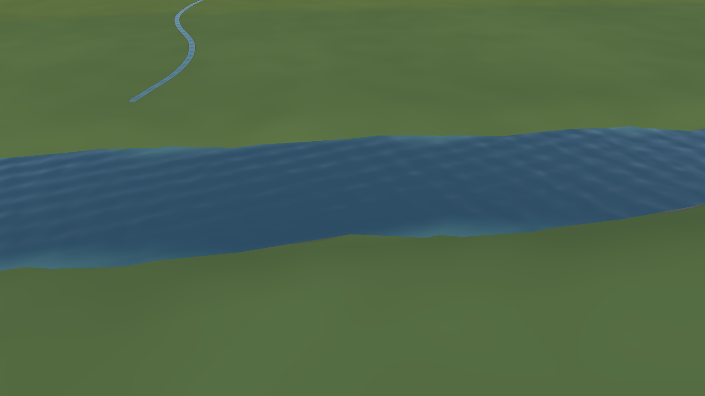
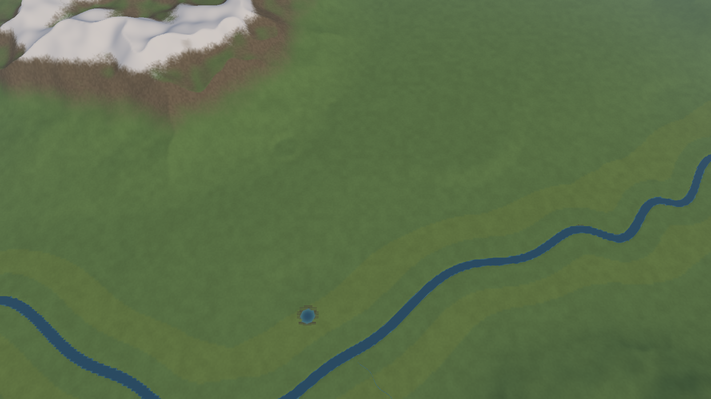

# 09 Wasser-Shader (Technical Artist TEAM-02, Design Sprint „Welt“, 02.11.2026)
Zweck: Einfacher, billiger Wasser-Shader für Fluss, Teich und Bach (Basti E2), mit Testszene, Bildern und Kostenmessung.
Status: Skizze, Phase 2. Dateien in der Arbeitskopie: `ws_c/slice/world/water.gdshader` (Material), `ws_c/slice/world/water_s7.gd` (Mesh-Builder), `ws_c/slice/tests/water_demo.gd` (Testszene). Kennung: [M] gemessen, [~] geschätzt.

## Prinzip
| Entscheidung | Warum |
|---|---|
| **Eigenes Wasser-Mesh** über dem Gelände (S7 färbt die Rinne nur im Terrain-Shader blau) | Pegel, Bewegung, Glanz und Ufer brauchen eine eigene Fläche. Das Gelände unter Wasser wird zum Flussbett (`c_wasser` = `#6B664F`). |
| **Opak, keine Transparenz** | kein Sortieren gegen Marker/Ghost, kein Depth-Prepass, keine Screen-/Depth-Textur. Läuft identisch im Compatibility-Renderer (opengl3). |
| **Tiefe als Vertexfarbe auf demselben Knotenraster und derselben Dreiecksteilung wie das Gelände** | Die interpolierte Tiefe ist pro Pixel exakt `Pegel − Gelände` und läuft an der Schnittlinie mit dem Ufer genau auf 0. Dort wird das Wasser zur Uferfarbe: **weiche Kante ohne Alpha**. |
| Bewegung nur über die Normale | 2 Sinuszüge in **festen** Weltrichtungen + 1 Wertrauschen. Der Fließvektor (UV, m/s) verschiebt das Muster in zwei Phasen (Flowmap-Prinzip ohne Textur), damit der Versatz nicht mit der Zeit wächst. |
| Himmel über Fresnel | Mischung zur Horizontfarbe (`SKY_HORIZON` aus `main.gd`), keine Reflexions-Probe, keine Screen-Space-Reflexion. |
| Teich/Bach mit demselben Shader | Teich: Fließvektor 0, Wellen × 0,45. Bach: Band-Mesh 5 m, Tiefe quer 0 → 0,8 m → 0. |

Ein Fehler aus dem ersten Versuch ist dokumentiert: Eine **je Vertex interpolierte Wellenrichtung** multipliziert sich mit Weltkoordinaten von einigen Kilometern und erzeugte Moiré-Streifen je Dreieck. Daher stehen die Wellenrichtungen fest, und nur der Versatz folgt dem Fluss.

## Parameter (Uniforms, Standardwerte)
| Parameter | Wert | Wirkung |
|---|---|---|
| `c_flach` / `c_tief` | `#55909C` / `#345F7E` | Farbe flach (Kies schimmert) → tief, voll ab `tiefe_voll_m` 2,5 m |
| `c_ufer` | `#6B7054` | = Terrain `c_ufer`, Zielfarbe an der Kante |
| `ufer_breite_m` | 0,35 m (Bach 0,25) | Tiefe, über die das Wasser in die Uferfarbe läuft |
| `saum_staerke` | 0,10 | heller Saum knapp vor dem Ufer (Schaum-Andeutung) |
| `wellen_skala` / `wellen_staerke` | 0,10 / m (≈ 10 m Welle) / 0,55 | ruhig; Ufer und Flaches automatisch ruhiger (`smoothstep(0, 1,2 m)`) |
| `fliess_periode_s` | 8 s | Phasenlänge des Versatzes |
| `fresnel_staerke` / `fresnel_basis` | 0,55 / 0,04 | Himmelsanteil bei flachem Blick (max. 80 %) |
| `rauheit`, SPECULAR | 0,30, 0,35 | Sonnenglanz gedämpft |
| `tiefe_skala_m` | 8 m | Kodierung COLOR.r |
| `m_pro_einheit` | 25 | Meter je Szeneneinheit |

Pegel (Builder `water_s7.gd`): tiefster Knoten im 6er-Umkreis + 3,5 m (der Generator gräbt die Rinne auf Pegel − 3,5 m), 3 × geglättet, Uferring 2 Felder. Fließvektor = Pegelgefälle, 0,6 m/s. Teich: Mulde in die Knoten gegraben (Demo: Ø 90 m, 2,5 m tief), Spiegel 0,3 m unter dem Rand.

## Bilder (`phase2/bilder/`)
| Ansicht | S7-Heightmap (Fluss 32–72 m) | ds_v2 (Fluss 60–100 m, 08) |
|---|---|---|
| Nah (160 m, 34°) | `s7_wasser_nah.png` | `ds_v2_wasser_nah.png` |
| Mittel (900 m, 45°) mit Teich und Bach | `s7_wasser_mittel.png` | `ds_v2_wasser_mittel.png` |
| Übersicht (5,6 km, 62°) | `s7_wasser_uebersicht.png` | `ds_v2_wasser_uebersicht.png` |
| Mühlteich (260 m) | `s7_wasser_teich.png` | `ds_v2_wasser_teich.png` |
| Bach 5 m (220 m) | `s7_wasser_bach.png` | `ds_v2_wasser_bach.png` |
| Vollbild (Kostenmessung) | `s7_wasser_vollbild.png` | `ds_v2_wasser_vollbild.png` |

Look-Befund: Nah ruhige, kleine Wellen, Kante weich ins Ufer, keine Treppen. Mittel und fern ein dunkles, klar lesbares Band. Der Teich unter 3 Feldern zeigt die 25-m-Rasterzacken (siehe 08: kleiner Teich = eigenes feines Mesh). Der Bach (5 m) ist ab etwa 1 km nur noch eine Haarlinie, darum braucht es den Ufergehölz-Saum (01, 08 d).

## Kosten [M]
Messung in `water_demo.gd`: je Ansicht 40 Frames mit Wasser-Shader, ohne Wasser und mit einfarbigem `StandardMaterial3D` auf denselben Meshes. Rechner: xvfb + llvmpipe (Software-OpenGL 4.5, Compatibility). **Die Millisekunden sind nur relativ zu lesen**, weil die CPU rastert.

| Karte | Ansicht | Draw Calls ohne → mit | Dreiecke ohne → mit | ms ohne Wasser | ms Einfarb | ms Shader | Shader ggü. Einfarb |
|---|---|---|---|---|---|---|---|
| s7 | nah | 3 → 5 | 24.576 → 29.960 (+5.384) | 121 | 126 | 134 | +6 % |
| s7 | mittel | 5 → 8 | 40.960 → 46.504 (+5.544) | 171 | 168 | 168 | -0 % |
| s7 | uebersicht | 36 → 39 | 294.912 → 300.456 (+5.544) | 444 | 428 | 401 | -6 % |
| s7 | teich | 3 → 5 | 24.576 → 29.608 (+5.032) | 134 | 140 | 136 | -3 % |
| s7 | bach | 3 → 5 | 24.576 → 29.960 (+5.384) | 136 | 133 | 132 | -1 % |
| s7 | vollbild | 1 → 2 | 8.192 → 13.064 (+4.872) | 129 | 119 | 137 | +15 % |
| ds_v2 | nah | 3 → 4 | 24.576 → 31.192 (+6.616) | 130 | 131 | 138 | +6 % |
| ds_v2 | mittel | 7 → 9 | 57.344 → 64.120 (+6.776) | 175 | 174 | 178 | +2 % |
| ds_v2 | uebersicht | 36 → 39 | 294.912 → 302.152 (+7.240) | 411 | 424 | 423 | -0 % |
| ds_v2 | teich | 4 → 6 | 32.768 → 39.544 (+6.776) | 139 | 133 | 139 | +4 % |
| ds_v2 | bach | 2 → 4 | 16.384 → 23.464 (+7.080) | 132 | 132 | 139 | +5 % |
| ds_v2 | vollbild | 1 → 2 | 8.192 → 14.808 (+6.616) | 119 | 123 | 137 | +12 % |

Zusammenfassung:
- **Draw Calls:** +1 je sichtbarem Wasser-Mesh (Fluss, Teich, Bach je 1). Übersicht +3.
- **Dreiecke:** Fluss S7 4.872, ds_v2 6.616; Teich 160; Bach ~500. Übersicht gesamt +5,5k (S7) bzw. +7,2k (ds_v2).
- **Perf-Gate Übersicht** (S7-Baseline 755.732 Dreiecke / 250 DC, `tests/perf_s7_baseline_s7.csv`): mit Wasser ≈ 763k / 253 DC, unter 1,0 M / 300 [~ additiv gerechnet, nicht im Spiel gemessen].
- **Pixelkosten:** ca. 200 ALU, 0 Texturzugriffe (Terrain-Shader ca. 100 ALU + 2 Zugriffe) [~]. Gemessen bei Vollbild-Wasser auf llvmpipe +8–15 % Frame gegenüber dem Einfarb-Material (drei Läufe; in Ansichten mit wenig Wasser liegt die Streuung von ±5 % über dem Effekt). Auf einer iGPU sind das grob 0,5–1 ms bei 100 % Wasser im Bild [~]. Typisch sind 1–5 % Wasser im Bild, also < 0,05 ms.
- Bauzeit Wasser-Mesh in GDScript 1,5–1,7 s für die ganze Karte (einmalig beim Laden, im Spiel in den WorkerThreadPool wie `terrain_s7.gd`).

## Grenzen (opengl3/Compatibility) und was bewusst fehlt
| Fehlt | Grund | Wenn später gewünscht |
|---|---|---|
| Echte Transparenz/Durchsicht auf den Grund | Sortierprobleme mit Markern/Ghost, Overdraw; Compatibility liest `hint_depth_texture` nur mit zusätzlichem Depth-Pass | Tiefe ist schon als Vertexfarbe da: „Durchsicht“ über `c_flach` → Grundfarbe genügt |
| Spiegelung von Ufer und Häusern | SSR gibt es im Compatibility-Renderer nicht, Planar-Reflection = zweite Kamera (doppelte Draw Calls) | Fresnel-Himmel reicht im Top-down-Winkel 36–62° |
| Uferschaum, Strömungslinien an Brückenpfeilern | Detail für 160-m-Nahsicht | `saum_staerke` hoch, Pfeiler als Tiefe-0-Punkte im Mesh |
| Wasserfall, Wehr | – | Kenney `cliff_waterfall*` + gleicher Shader mit steiler UV |
| Pegel- oder Jahreszeitwechsel | statisches Mesh | Pegel-Uniform als Offset |
| Glatte Uferlinie bei engen Mäandern | Uferlinie = Schnitt mit dem 25-m-Gelände, bei ds_v2 sichtbare Zacken (`ds_v2_wasser_mittel.png`) | Uferböschung im Generator ≥ 40 m statt 22 m, oder Gelände und Wasser im Flusskorridor auf 12,5 m unterteilen (+~10k Dreiecke) |

## Gegenpositionen
| Wer | Position | Antwort |
|---|---|---|
| Sophie (Art) | **Textur-/Flowmap-Wasser** (Normal-Map + Flowmap) sieht nah deutlich lebendiger aus, prozedurale Sinuswellen wirken nah „gekachelt“. | Gilt für Nahsicht unter 100 m, die wir kaum zeigen. Eine Flowmap bräuchte eine Textur, die aus dem Generator kommt (512² RG), ein Normal-Map-Asset und 2–4 Zugriffe je Pixel. Der Shader ist so geschnitten, dass `wellen_grad()` 1:1 durch Normal-Map-Zugriffe ersetzt werden kann, ohne Mesh oder Builder zu ändern. |
| Felix (Technik) | Ein eigenes Mesh mit Uferring ist doppelte Geometrie entlang des Ufers (Z-Fighting-Gefahr). | Die Schnittlinie liegt bei Tiefe 0, wo beide Flächen dieselbe Farbe (Ufer) zeigen. Ein Flackern ist dort unsichtbar und in den Bildern nicht aufgetreten. Quads mehr als 1 m über dem Spiegel werden nicht gebaut. |
| Mira (UI) | Ohne Transparenz sieht man nicht, ob der Fluss passierbar (seicht) ist. | Passierbarkeit ist Sim (Brückenfelder), nicht Optik. Seicht ist über die Farbe sichtbar (`c_flach`). |

## Offene Fragen an Basti
1. **Look:** Reicht dir das ruhige, opake Wasser mit weicher Kante (Bilder nah/mittel), oder wünschst du sichtbare Durchsicht auf den Grund? Die wäre teurer, und im Compatibility-Renderer gibt es Sortierrisiken.
2. **Bach in der Ferne:** Darf der 5-m-Bach ab etwa 1 km als Zeichenlinie mit fester Pixelbreite erscheinen (siehe 01, Frage 1), oder verschwindet er dort bewusst?
